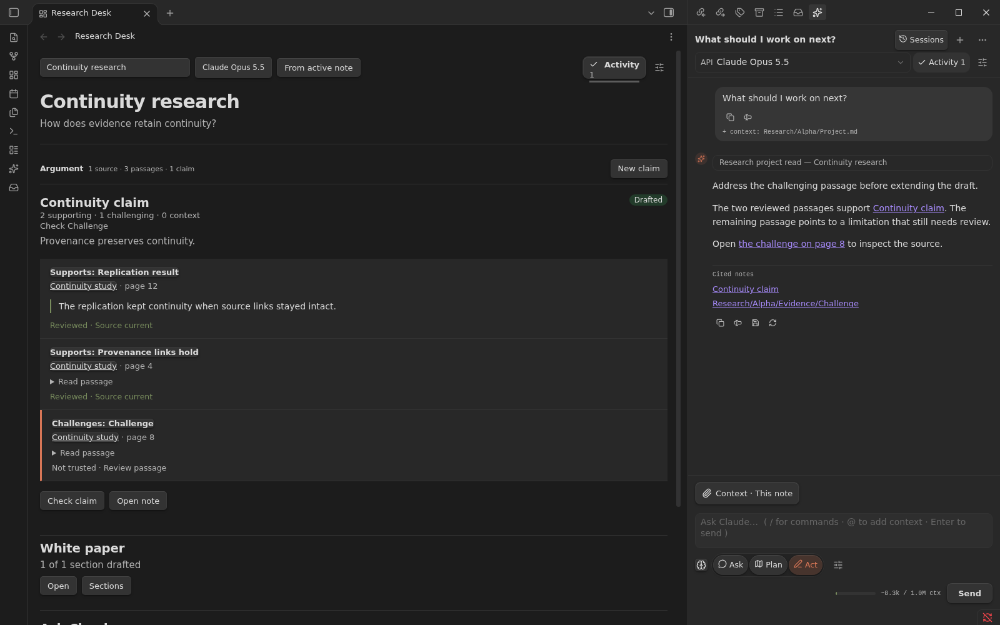
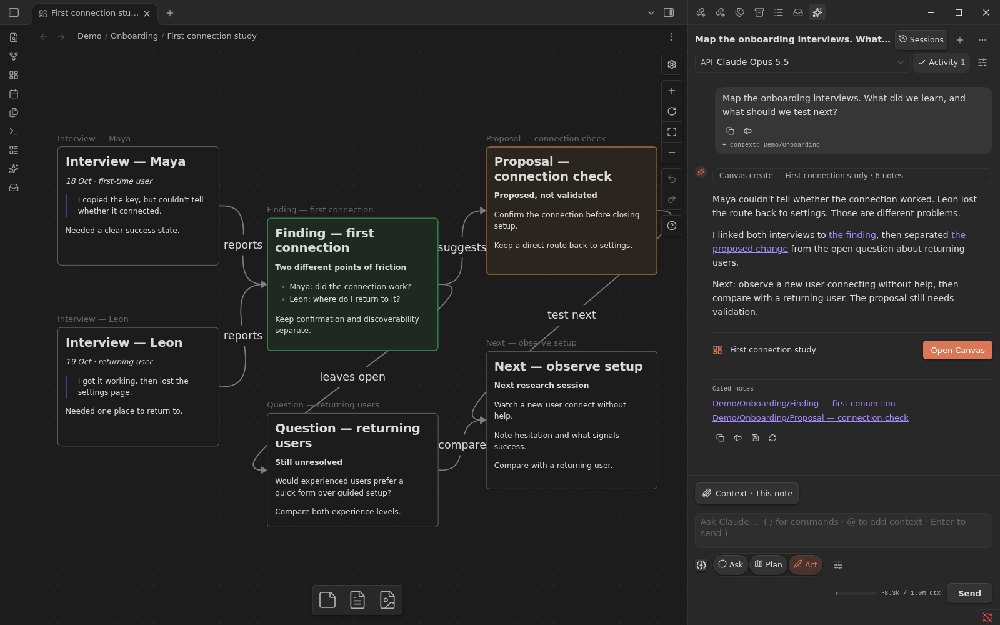

# Companion for Claude

Bring your notes, sources and AI into the same workspace.


[](https://github.com/cavi-ai/claude-obsidian/actions/workflows/obsidian-plugin-ci.yml)
[](LICENSE)

Companion helps you research, write and create inside [Obsidian](https://obsidian.md).
Find relevant notes and PDF passages, develop a source-linked argument, turn it
into a draft or interactive artifact, and review edits before they change your notes.

[**Install Companion for Claude**](https://obsidian.md/plugins?id=claude-companion)
· [Quick start](#quick-start)
· [Read the guides](#guides)

Install the plugin from the store link above. To build or contribute, start
with [CONTRIBUTING.md](https://github.com/cavi-ai/claude-obsidian/blob/92e770e2fd5a12f546fdb185097d99833994a52b/CONTRIBUTING.md) and the [plugin source](https://github.com/cavi-ai/claude-obsidian/blob/92e770e2fd5a12f546fdb185097d99833994a52b/obsidian-plugin).
The public release repository is
[companion-for-claude](https://github.com/cavi-ai/companion-for-claude).

## Quick start

1. In Obsidian, open **Settings → Community plugins → Browse**, search for
   **Companion for Claude**, then install and enable it.
2. Open Companion and choose a signed-in Claude Code, Codex, or OpenCode CLI on
   desktop, an Anthropic API key on any device, or a local model.
3. Open a project note, turn on the **Note** context chip and choose **Act**.
   Start with a question worth answering:

   > Find the notes and PDF passages that support or challenge this idea.
   > Give me a source-linked outline before drafting.

[Try a reviewed note edit →](#try-one-note-edit-you-control) ·
[Full setup guide →](guides/getting-started.md)

## Try one note edit you control

Create a sample project note:

```markdown
# Reading list
Goal: Build a personal reading list.
Constraint: Keep it single-user; do not add account registration.
Next step: Choose the smallest useful first screen.
```

After [setup](guides/getting-started.md), open the note and enable the **Note**
context chip. Select **Act** and keep **Allow write tools** enabled. Ask:

> Propose a clearer next step for this project. Keep its constraints unchanged
> and show the note edit for review.

Review the proposed hunks. Accept a useful change and reject any change to your
meaning, then inspect the note: did the next step improve while the constraint
stayed intact? The model may propose one hunk or several; rejecting the entire
proposal is a valid outcome.

Model access is separate. Attached context is sent through the backend you
select. See [edit review and guardrails](guides/agent-mode.md).

## Put your notes to work

Work develops across many notes and many sessions. Companion keeps your sources,
drafts and decisions together in the vault where you already think.

### Find the passage you remember

Combine keyword and on-device semantic search to find relevant notes and PDF
passages, even when you do not remember the exact words. Bring the active note,
selections, links, folders and images into the conversation. Agent mode can
search, read and follow links, with every tool step visible.

[Explore context and agent mode →](guides/agent-mode.md)

### Keep the argument connected to its sources

Research Desk brings sources, passages, claims, outlines and drafts into one
project. See what supports a claim, what challenges it and which section needs
work. Review the evidence and preview a draft before accepting it. Research
records remain ordinary Markdown notes in your vault.

<p align="center">
  
</p>

[See the research workflow →](guides/research-workbench.md)

### Make something from what you find

Turn your research into a draft, an interactive HTML artifact, a native Canvas
or an Obsidian Base. Notes, artifacts and project records stay alongside the
material that informed them.



[Explore interactive artifacts →](guides/artifacts.md)

### Keep the final word

Review proposed note edits and accept or reject individual changes before
applying them. Other write tools ask for confirmation unless you grant access
for the session. Conversations persist across restarts; an interrupted turn
returns as stopped work with a **Retry** action.

[Learn about edits and guardrails →](guides/agent-mode.md#editing-notes-diffs-not-writes)

## Choose your connection

- **CLI sign-in** — desktop chat through an installed, signed-in Claude Code,
  Codex, or OpenCode command. Each CLI keeps its own credentials.
- **Anthropic API** — direct streaming chat on desktop and mobile with your API
  key, long-term OAuth token, or environment credential.
- **Local models** — Ollama or an OpenAI-compatible endpoint for chat and
  utility work. Tool-capable Ollama models can run the vault agent locally.
- **On-device GPU chat** — a downloaded model runs inside Obsidian on supported
  hardware. See the [local model guide](guides/local-models.md) for setup and
  backend capabilities.
- **Auto** — start with Claude and fall back to a reachable local model when
  Claude is offline, rate-limited, or unavailable.

[Authentication and cost →](guides/auth.md) ·
[Local models and on-device search →](guides/local-models.md)

## Built for control

- **Reviewable by default.** Agent writes require confirmation; diff-based edits
  require explicit hunk acceptance.
- **Local-first where it matters.** Semantic embeddings run on device. The
  optional MCP bridge binds to `127.0.0.1`, requires a bearer token, and keeps
  writes disabled until you enable them.
- **Your vault remains yours.** Research records, artifacts, Canvas files,
  Bases, and generated notes are ordinary vault files. Conversations persist
  across restarts without becoming a separate knowledge store.
- **Extensible without being tangled.** Companion can expose live-vault tools
  through its optional MCP bridge and consume explicitly configured external
  MCP servers from agent mode.

[Privacy and data flow →](#what-leaves-your-machine) ·
[MCP bridge security and setup →](guides/claude-code-bridge.md)

## Companion and portable workflows

This repository contains two related products with separate jobs:

- [`obsidian-plugin/`](https://github.com/cavi-ai/claude-obsidian/blob/92e770e2fd5a12f546fdb185097d99833994a52b/obsidian-plugin) is **Companion for Claude**, the
  Obsidian community plugin described on this page.
- [`claude-plugin/`](https://github.com/cavi-ai/obsidian-agent) is the pinned
  **obsidian-agent** project: portable workflows for Claude, Codex, Gemini,
  OpenCode, and AgentSkills hosts using the official Obsidian CLI. It does not
  require Companion or MCP.

[Explore portable workflows and supported hosts →](https://github.com/cavi-ai/obsidian-agent)

## Guides

- [Getting started](guides/getting-started.md)
- [Agent mode, edits, and guardrails](guides/agent-mode.md)
- [Research Desk](guides/research-workbench.md)
- [Interactive artifacts](guides/artifacts.md)
- [Local models and semantic search](guides/local-models.md)
- [Claude Code and the MCP bridge](guides/claude-code-bridge.md)
- [Authentication and cost](guides/auth.md)
- [Architecture](guides/architecture.md)
- [FAQ](guides/faq.md)

<details>
<summary><strong>Build from source</strong></summary>

```bash
git clone --recurse-submodules https://github.com/cavi-ai/claude-obsidian.git
```

Already cloned without submodules:

```bash
git submodule update --init --recursive
```

See [`obsidian-plugin/README.md`](https://github.com/cavi-ai/claude-obsidian/blob/92e770e2fd5a12f546fdb185097d99833994a52b/obsidian-plugin/README.md#development-and-testing)
for development and test commands.

</details>

## Open source

[Contributing](https://github.com/cavi-ai/claude-obsidian/blob/92e770e2fd5a12f546fdb185097d99833994a52b/CONTRIBUTING.md) · [Security](https://github.com/cavi-ai/claude-obsidian/blob/92e770e2fd5a12f546fdb185097d99833994a52b/SECURITY.md) ·
[Code of conduct](https://github.com/cavi-ai/claude-obsidian/blob/92e770e2fd5a12f546fdb185097d99833994a52b/CODE_OF_CONDUCT.md) · [Attribution](https://github.com/cavi-ai/claude-obsidian/blob/92e770e2fd5a12f546fdb185097d99833994a52b/NOTICE) · [MIT license](LICENSE)

The interface aesthetic is an original reformulation inspired by Thariq
Shihipar's [“unreasonable effectiveness of HTML”](https://github.com/ThariqS/html-effectiveness)
gallery. Steph Ango's [Obsidian Skills](https://github.com/kepano/obsidian-skills)
serve as format references for Obsidian-native output. Both upstream projects
are pinned, unmodified submodules with full attribution in [`NOTICE`](https://github.com/cavi-ai/claude-obsidian/blob/92e770e2fd5a12f546fdb185097d99833994a52b/NOTICE).

## What leaves your machine

Companion has no telemetry or analytics. Network activity follows an action you
take or a backend you choose.

- **Anthropic or your API base URL:** a direct-API chat, agent, or utility turn
  sends the prompt, attached vault context, and system prompt.
- **The installed `claude` command:** a desktop Claude Code turn sends the
  prompt and attached vault context to the CLI, which owns authentication and
  service traffic.
- **Your Ollama host or OpenAI-compatible endpoint:** selecting that backend
  sends the request to the server you run.
- **Tag classifier model:** **Check with model** in Optimize brain sends tag
  names and up to 3 note titles per tag to the configured classifier model; in
  the background it runs only when the classifier is served from this machine
  or a private-network address (`localhost` or a loopback or private-range IP);
  no other host name qualifies.
- **Note type classifier model:** **Check with model** in the type review sends
  each untyped note's title, folder, up to 10 tags, up to 5 headings, and its
  first 200 characters, plus the names of the ontology types and up to 6
  property keys per type, to the configured classifier model. Secrets
  (API keys, tokens, passwords) are removed from note text before sending. It
  runs only on that click, never in the background.
- **Hugging Face and jsDelivr:** the one-time embedding download requests only
  the model and ONNX runtime after you approve it; both are cached.
- **Cloud-session services:** **Send to cloud Claude session** sends the prompt
  and attached note context to your configured routine fire URL. Pulling cloud
  replies sends the repository, branch, and folder you configured to GitHub.
- **Research services:** an explicit discovery or import action sends search
  terms or bibliographic identifiers to OpenAlex, Crossref, arXiv, or Zotero.
- **Web pages and search services:** web capture, `web_fetch`, and `web_search`
  send only the URL or query you supplied.
- **External MCP servers:** a tool call you confirm sends that tool's arguments
  to the server you configured.

Semantic and keyword indexes stay on device. Credentials live in Obsidian's
encrypted secret storage, never the vault-synced `data.json`. Desktop shell
execution uses argument arrays rather than shell strings and covers only the
Claude/Obsidian CLIs, browsers you select for artifacts, and stdio MCP servers
you configure; it is disabled on mobile.

For the complete endpoint, WebAssembly, site-specific capture, and cloud-session
details, see [Authentication and cost](guides/auth.md),
[Local models](guides/local-models.md), and the
[architecture guide](guides/architecture.md).

## Artifact security

Companion renders a fenced ```` ```claude-html ```` block in a sandboxed iframe
with scripts allowed but same-origin access denied. A restrictive content
security policy blocks network requests and form submissions, so the artifact
cannot reach the vault, cookies, or remote services. Saving an artifact writes
the same block to a normal Markdown note.

[Artifact behavior and authoring examples →](guides/artifacts.md)

## Development and testing

All commands run from this directory:

```bash
pnpm install
pnpm run typecheck
pnpm run lint
pnpm test
pnpm run docs:verify
pnpm run build
```

To install a development build, copy `main.js`, `manifest.json`, and
`styles.css` to `<vault>/.obsidian/plugins/claude-companion/`, then enable
**Companion for Claude** in Community plugins. `pnpm run dev` watches and
rebuilds `main.js` for active development.

See [`CONTRIBUTING.md`](https://github.com/cavi-ai/claude-obsidian/blob/92e770e2fd5a12f546fdb185097d99833994a52b/CONTRIBUTING.md) for the full gate and release
workflow.
