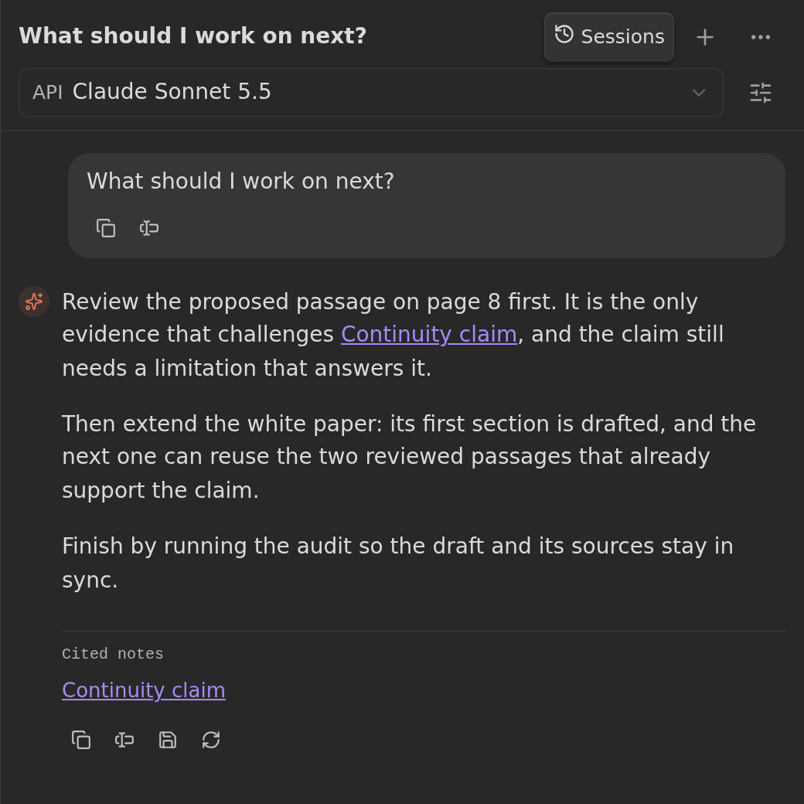
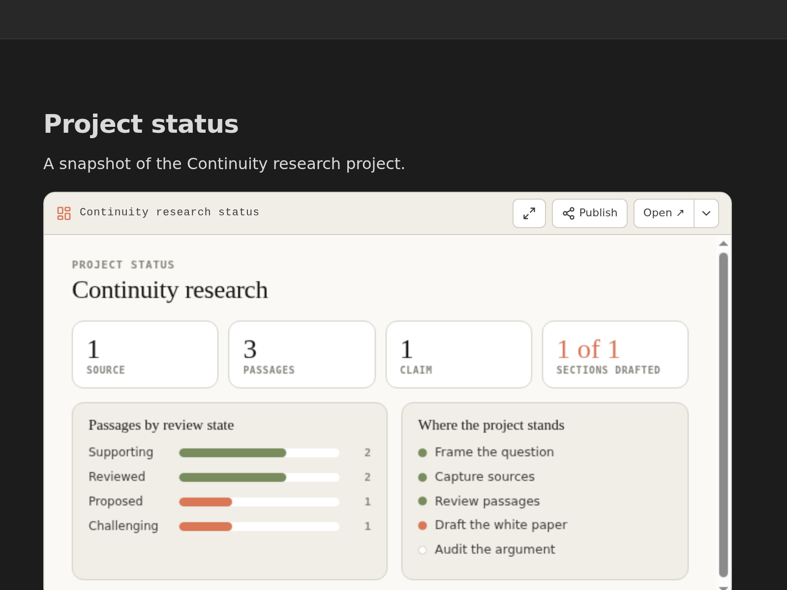
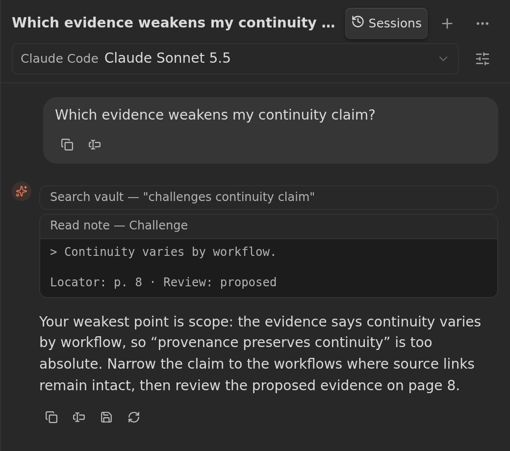

# Getting started

Install Companion for Claude, connect Claude, and get to a useful first answer.
The API-key path takes no terminal; desktop subscribers can instead use an
already installed and signed-in Claude Code, Codex, or OpenCode CLI.

## 1. Install

**From the community store** — *Settings → Community plugins → Browse* → search
**"Companion for Claude"** → *Install* → *Enable*. Or
[open it directly in Obsidian](obsidian://show-plugin?id=claude-companion).

**Pre-release builds (BRAT)** — install the
[BRAT](obsidian://show-plugin?id=obsidian42-brat) plugin, then *Add beta plugin*
and enter `cavi-ai/companion-for-claude`. Releases are published from that mirror
repo; the store listing tracks it.

## 2. Connect Claude

On desktop, the first-run card offers **Use Claude Code sign-in**, **Use Codex
sign-in**, or **Use OpenCode sign-in** for installed, signed-in commands. Each CLI
keeps its own credentials. These connections are desktop-only and cover chat;
utility work such as source enrichment uses its separately configured provider.

The simple path on every device is an Anthropic API key:

1. Open Companion from the sparkles ribbon icon or **Open chat panel** command.
2. On the **Connect to Claude** card, paste your Anthropic API key. The card links
   to the [Anthropic Console](https://console.anthropic.com/settings/keys) if you need one.
3. Click **Connect** or press **Enter**, then read the connection result. A failed
   check leaves the card visible with its error.

Use **Other connections…** for local models or advanced connection settings.
The first connection does not require the setup wizard.

You pay Anthropic for usage; nothing is billed by this plugin, and there is no
account to create with us.

Already have a Claude subscription, a long-term OAuth token, or an
`ANTHROPIC_API_KEY` in your shell? See [auth.md](auth.md) for the differences
and for pointing direct API traffic at a gateway.

## 3. Your first chat

Open the panel from the sparkles ribbon icon (*Open Companion for Claude*) or the
command palette (*Open chat panel*).

Use the model button in the chat header to choose a backend and model. On wide
panes, the composer offers the same choices. **Sessions** opens saved
conversations; **Activity** opens current work and recovery actions. Close a panel
with its **Close** button, Escape, or a click outside it. Feedback stays below the
header and has a **Dismiss** button.

Above the composer is a row of **Context** chips. Toggle one on and its content
rides along with your next message:

- **Note** — the note you're looking at.
- **Selection** — just the text you highlighted.
- **Linked / Backlinks** — notes the active note points at, and notes pointing back.
- **Search** — a keyword (or semantic, if enabled) sweep of the whole vault.

You can also **@-mention** a specific note, folder, PDF, or image in the
composer, or paste a screenshot straight into it.

Paste a **URL** and you'll get a pill offering to attach the page — Companion
fetches it and reduces it to clean readable markdown (the same Defuddle engine
behind Obsidian's Web Clipper). The fetch only happens when you ask for it, and a
failure shows on the pill instead of derailing the chat.

Try: open a note with some substance, toggle **Note**, and ask
*"What am I actually claiming here, and what's unsupported?"*

Companion trims attached context to a character budget (default 24,000
characters, 6 notes) so a big vault can't blow up a request. Both are adjustable
under *Settings → Companion for Claude → Chat & models → Prompts & context*.

### Review a note change

Try the [sample-note exercise](../README.md#try-one-note-edit-you-control):
ask for a clearer next step while preserving a single-user constraint. Inspect
and accept or reject the proposed changes before checking the saved note.
[Edit review](agent-mode.md#editing-notes-diffs-not-writes) explains how hunks
are applied; creating a new note uses a separate write confirmation.

## 4. Your first artifact

Type `/` in the composer to open the slash palette — 24 built-in commands plus
your workflows, fuzzy-searchable.

Pick **`/artifact`** with a note open. Claude replies with a fenced
`claude-html` block, and Companion renders it **inline in the chat, inside a
sandboxed iframe** — a real interactive page, not a picture of one.

From there you can open it in your real browser or save it as a portable note.
See [artifacts.md](artifacts.md) for the sandbox rules and the design system.

Other good first commands: `/summarize`, `/ask` (answers across the whole
vault), `/diagram`, `/canvas`, `/research`.

### Your own slash commands

Any Markdown note in your **templates folder** (*Settings → Companion for Claude
→ Storage → Templates folder*, default `Claude/Templates`) becomes a slash
command. Frontmatter carries `name` and `description`, plus optional `model` and
context-toggle defaults; the body is the prompt.

`{selection}` and `{active_note}` are substituted at run time — unknown
placeholders are left alone rather than mangled. A note named `Standup Summary`
becomes `/standup-summary`.

## 5. Agent mode

Agent mode is **on by default**. It's what lets Claude search and read your vault
on its own mid-answer instead of relying only on the chips you pre-attached. Each
step it takes shows up as a tool chip you can expand.

Under *Settings → Companion for Claude → Vault access*:

- **Read and search notes** — the read-only loop (search, read, follow links). On by default. Turn it off for plain chat with only pre-attached context.
- **Create and edit notes** — also lets Claude create, edit, and move notes. On by default. Each write asks first unless you grant access for the session; the header’s write-permission button revokes that grant.
- **Max tool iterations per turn** (under **Agent behavior**) — how many search/read/write rounds Claude may take before it has to answer. Default 10.

Note edits are a separate, safer path: Claude proposes exact replacements. If
the target note is open, you review word-level changes directly in the editor;
otherwise Companion opens the red/green modal. Only accepted hunks are written,
even with write tools off.

The agent isn't Claude-only: on the **Local only** backend it runs against your
Ollama server too, as long as the selected model supports tools (settings badge
each detected model's tools/thinking capabilities). The composer's **reasoning
indicator** lights up whenever the active backend thinks before answering.

Full detail in [agent-mode.md](agent-mode.md).

## 6. Desktop integrations

The in-chat Claude Code backend does **not** require the background MCP bridge.
On desktop, open
**Options → Desktop integrations** from any Companion page (or use the button at
the top of Companion settings) for two optional connections:

- **Claude Code** — Companion checks for the `claude` and official `obsidian`
  CLIs, then can add `cavi-ai/plugins` and install `obsidian-agent@cavi-ai` at
  user scope with one confirmed action. Claude Code uses the official Obsidian
  CLI by default; no background MCP server is needed. The Obsidian CLI has to be
  on first — **Open Obsidian CLI settings** in that panel takes you straight to
  the switch and the Register step (Obsidian 1.12.7+). See
  [claude-code-bridge.md](claude-code-bridge.md) for both steps and for what
  *installed, not responding* means.
- **Claude Desktop** — the confirmed setup enables Companion's read-only
  loopback MCP bridge and merges an `obsidian-vault` entry into Claude
  Desktop's local configuration. Restart Claude Desktop after setup and keep
  Obsidian open while using it.

Companion never installs Claude Code or Obsidian itself, silently edits external
configuration, or enables MCP writes. See
[claude-code-bridge.md](claude-code-bridge.md) for manual recovery and the
advanced live-vault API.

## Next steps

- [agent-mode.md](agent-mode.md) — the loop, the tools, the guardrails.
- [artifacts.md](artifacts.md) — `claude-html` blocks and the sandbox.
- [research-workbench.md](research-workbench.md) — evidence-backed writing.
- [claude-code-bridge.md](claude-code-bridge.md) — CLI-first Claude Code and optional Claude Desktop/live-vault MCP.
- [local-models.md](local-models.md) — Ollama fallback and on-device semantic search.
- [auth.md](auth.md) — Claude Code sign-in vs direct API credentials.
- [faq.md](faq.md) — cost, privacy, mobile, troubleshooting.
